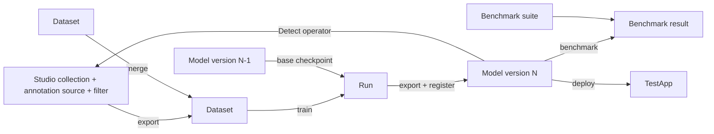

# Pipeline platform plan: datasets, experiments, model versions, benchmarks

Status: draft v1, 2026-10-27. Decisions marked **Decision** are proposals to confirm;
questions marked **Open** need your answer before the phase that uses them.

## 1. Where we are

The fork already covers the annotation side of the loop:

| Capability | Where it lives | State |
|---|---|---|
| Ingest images and videos by drag and drop, with tags | `lightly_studio/upload/`, `MediaDropZone` | done |
| Annotate, filter, embed, evaluate | upstream LightlyStudio | kept as is |
| Auto-annotate with a model from a folder | `projects/pipeline/detect_operator.py`, `projects/models/` | done |
| Export a training-ready COCO dataset, merge, preview | `lightly_studio/pipeline_datasets/`, Train panel | done |
| Train, version, benchmark, deploy | nothing yet | this plan |

Outside the fork, two things exist that the plan has to absorb rather than rewrite:

- `SLM/annotations/yolox` plus `SLMmodelv2/exps/*.py` and `export_onnx.py`: the YOLOX
  training and export flow, driven by hand-written exp files and shell commands.
- `SLM/TestApp`: the consumer of the model. It runs the gate-arm state machine and blink
  counting over a video and produces movement timings, LED reports and per-frame timing
  stats. It already has evaluation helpers (`evaluate_model_samples.py`,
  `characterize_movement.py`, `recalibrate_references.py`).

The goal is one project where a model goes from frames to a deployed ONNX with every step
recorded, comparable and repeatable, in the spirit of ZenML or MLflow but without adopting
either (see §3.4).

## 2. Principles

1. **Files are the source of truth, the database is the index.** A dataset is a folder, a
   run is a folder, a model version is a folder. Deleting the database loses nothing that
   cannot be rebuilt by scanning the folders. This is what makes the system survivable and
   inspectable, and it is how the COCO datasets already work (`dataset.json` manifests).
2. **Immutability after creation.** Datasets, runs and model versions never change once
   written; anything new is a new entity with a pointer to its parents. Comparisons are only
   meaningful when the things compared do not move.
3. **Lineage everywhere.** Every model version knows its run, every run knows its dataset
   and base checkpoint, every dataset knows the Studio collection, annotation source and
   filter it came from, and every benchmark knows the model version and the suite.
4. **LightlyStudio stays the annotation core, untouched where possible.** New capabilities
   go into fork-only modules and the `projects/` tree, so upstream merges stay feasible.
5. **One process, no services.** The backend owns a job runner; training runs as a
   subprocess the backend supervises. No message queue, no second server, no cloud.

## 3. Storage architecture

### 3.1 The constraint that decides it

Studio runs on DuckDB with a single writer per database file, and its engine is built
around exactly one connected database. Pipeline work has a different write pattern: long
training runs that append metrics every few seconds, benchmark runs that write hundreds of
rows at once, and all of it happening while someone annotates in the GUI. Putting that into
the Studio database means a training job and the annotation GUI fight over one writer, and
a Studio schema change on an upstream merge drags our tables along.

### 3.2 Options considered

| Option | Shape | Verdict |
|---|---|---|
| A. Everything in the Studio DB | New tables next to Studio's | Rejected: writer contention, coupled to upstream schema, a `make start-pipeline-clean` would wipe experiments |
| B. One registry DB next to the Studio DB, folders as truth | `projects/registry.db` indexing `datasets/`, `runs/`, `models/`, `benchmarks/` | **Decision: this** |
| C. One child DB per dataset or experiment | Many small DuckDB files, a parent that lists them | Rejected: no query across experiments without attaching every file, no leaderboard without a merge step, more lock surface, not what "parent and child" buys in practice |
| D. Adopt ZenML or MLflow | External tracking server plus its own store | Deferred: heavy for a single-machine setup, and MLflow's tracking schema can be mirrored later by an exporter if a team tool is wanted |

"Parent and child databases" are the right mental model, but not as database files. The
parent is the registry; the children are folders with manifests. A dataset's "child
database" is its `annotations/instances_*.json` and `dataset.json`; a run's is its
`metrics.jsonl` and `run.json`. The registry holds only what you need to list, filter,
join and rank.

### 3.3 Files and databases

```
projects/
  lightly_studio_pipeline.db     Studio: samples, annotations, tags, embeddings (unchanged)
  registry.db                    pipeline index: datasets, experiments, runs, models, benchmarks
  uploads/<collection>/          raw media added through the GUI (unchanged)
  datasets/<name>/               immutable COCO folders with dataset.json (unchanged)
  runs/<run_id>/                 one folder per training run
      run.json                   config snapshot, dataset hash, base checkpoint, git SHAs, hardware
      exp.py                     the YOLOX exp file as generated for this run
      metrics.jsonl              one line per epoch or eval: loss, mAP, lr, time
      log.txt                    subprocess stdout and stderr
      checkpoints/               best_ckpt.pth, last_epoch_ckpt.pth
      export/model.onnx          exported at the end of the run, plus classes.txt
  models/<model_name>/<version>/ one folder per model version
      model.onnx, classes.txt
      model_card.json            run_id, dataset hash, classes, input size, metrics at export, stage
  benchmarks/<suite_name>/       reference videos and expected outputs for TestApp-level tests
      suite.json                 videos, expected gate timings and blink counts, tolerances
  benchmarks/results/<id>/       what one benchmark run produced, incl. per-video reports
```

The registry is DuckDB too, through the same SQLModel layer the backend already uses, with
its own engine and its own Alembic-free `create_all` schema. It never shares a session
with the Studio database. Cross references into Studio (collection ids, annotation source
names, tag names) are stored as plain values, never as foreign keys.

**Decision:** `projects/models/` changes shape from flat `<name>.onnx` files to
`<model_name>/<version>/`. The Detect operators then register one entry per model version,
or only the versions in stage `staging` and `production` (see §5.4), which also fixes the
"one operator per file" sprawl as the model count grows.

### 3.4 Why not ZenML or MLflow now

They solve orchestration across machines and teams. Here there is one machine, one GPU,
one team, and a GUI that is already the control surface. What we actually need from them,
a run ledger, artifact lineage, a model registry with stages and a comparison view, fits in
a few tables and the existing panel. If the team later wants MLflow's UI or a shared
server, a `registry → MLflow` exporter is a day of work because every run already has a
manifest. Building on the fork's own tables keeps the training loop inside the tool, which
is the point of the fork.

## 4. Data model

### 4.1 Entities

| Entity | Identity | Key fields | Source of truth |
|---|---|---|---|
| Dataset | `name` | content hash, parents (for merges), classes, split counts, Studio collection, annotation source, filter snapshot, created_at | `datasets/<name>/dataset.json` |
| Experiment | `name` | description, task (detection), default exp template | registry only |
| Run | `run_id` (ulid) | experiment, dataset hash, base checkpoint (model version or external file), config, status, started/finished, git SHA of yolox and of the fork, GPU, final metrics, artifact paths | `runs/<run_id>/run.json` |
| Metric point | run_id, step, name | value, timestamp | `runs/<run_id>/metrics.jsonl` |
| Model | `name` | description, task, class list contract | registry only |
| Model version | model name, `version` (int, auto) | run_id, onnx path and hash, classes, input size, export settings, stage, notes, promoted_at | `models/<name>/<version>/model_card.json` |
| Benchmark suite | `name` | kind (coco_map, studio_eval, testapp_regression, latency), inputs (dataset or videos), expected outputs, tolerances | `benchmarks/<suite>/suite.json` |
| Benchmark result | `result_id` | suite, model version, metrics, pass/fail, artifacts, duration, device | `benchmarks/results/<id>/result.json` |
| Deployment | target (`testapp`) | model version, deployed_at, by | registry plus the target's own pointer file |

### 4.2 Lineage



The last edge closes the loop: a registered version becomes a Detect operator in Studio,
its predictions get reviewed, the corrected annotations become the next dataset.

### 4.3 Versioning rules

- **Dataset hash** is the SHA-256 of the two instances JSONs plus the sorted list of file
  names and sizes. Two exports with identical content get the same hash, which is what
  lets a run say "trained on exactly this" even if the folder was renamed.
- **Run config** is the generated exp file plus the CLI arguments, stored verbatim. Seeds
  are fixed and recorded. Reproducing a run means rerunning its folder.
- **Model version** numbers are per model name and never reused. The name is the family
  (`yolox_m_slm`), the version is the increment (`7`). The on-disk folder is
  `models/yolox_m_slm/7/`. Legacy files such as `yolox_m_slm_v4.onnx` are imported as
  versions with `run_id = null` and a note, so the history is not lost.
- **Stages** per model version: `candidate` (fresh from a run), `staging` (passed the
  regression suite), `production` (what TestApp runs), `archived`. Only one version per
  model is `production` at a time; promotion is explicit and logged.

## 5. Components to build

### 5.1 Registry (backend)

A `lightly_studio/registry/` package: engine and session for `registry.db`, SQLModel
tables for §4.1, a `reindex` command that rebuilds the tables from the folders, and a
small resolver layer. The existing `pipeline_datasets` service writes a dataset row on
export and merge, and a startup hook reconciles rows with folders.

### 5.2 Job runner (backend)

Training and benchmarking take minutes to hours, so they cannot run inside a request.
A `jobs` table in the registry and a worker thread in the backend process:

- A job is a row with kind (`train`, `benchmark`, `export`), parameters, status, pid, log
  path and timestamps. The GUI polls `GET /jobs/{id}` every few seconds.
- Training runs as a subprocess of the YOLOX `tools/train.py` inside `runs/<run_id>/`,
  with stdout captured to `log.txt`. A parser turns YOLOX's epoch lines into
  `metrics.jsonl`. GPU memory capping stays in the generated exp file as it is today.
- Cancel sends SIGTERM to the subprocess and marks the job `cancelled`.
- One job at a time by default (one GPU); a queue is just jobs in status `queued`.
- The Studio database is never touched by the worker; the registry is, so there is no
  contention with annotation.

### 5.3 Training (YOLOX first, pluggable later)

A `trainers/yolox.py` adapter: given a dataset folder, a base checkpoint, and a few
knobs (epochs, batch size, input size, learning rate, fp16), it generates the exp file from
a template that mirrors `slm_v4_yolox_m.py`, launches training, and at the end exports
ONNX with the repo's `export_onnx.py` logic (stock exporter is broken on current torch).
The adapter is the only place that knows YOLOX; a second trainer later implements the
same interface.

### 5.4 Model registry (backend + Train panel)

- Register a version from a run's export, or import an external ONNX with a classes file.
- The Detect operators read the registry instead of scanning the folder, and register the
  `staging` and `production` versions by default, with a setting to expose all.
- Promotion endpoints enforce the one-production rule and record who and when.

### 5.5 Benchmarks

Four suite kinds, each a runner behind the same job interface:

1. **COCO mAP** on a dataset's validation split (pycocotools through YOLOX's evaluator).
   Reports mAP@0.5, mAP@0.5:0.95, per-class AP, and precision and recall at the deployed
   score threshold.
2. **Studio evaluation**: run the version as a Detect operator over a preview dataset
   and read Studio's own evaluation run. Useful for browsing failures image by image.
3. **TestApp regression**: run `TestApp` on reference videos in a suite and compare the
   summary against expected values: descent, down and ascent timings within a tolerance,
   blink counts per light, state sequence. This is the acceptance gate that matters for
   the product and it reuses `video_pipeline.process` as a library call.
4. **Latency**: frames per second and p95 per device (CPU, CUDA, later DirectML on the
   target box), measured with the TestApp preprocessing path.

Results feed a leaderboard: one row per model version, one column per suite metric,
sortable, with the production version pinned. A benchmark result is immutable; rerunning
a suite creates a new result.

### 5.6 GUI (Train panel grows into a workspace)

The Train tab becomes a panel with sub-tabs:

- **Datasets**: what exists today, plus the hash, parents and "used by N runs".
- **Runs**: new run form (experiment, dataset, base version, knobs), live log tail,
  metric chart per run, compare two runs.
- **Models**: versions grouped by model name, stage badges, promote and archive, register
  from run, import file, "use as Detect operator".
- **Benchmarks**: suites, run a suite on a version, leaderboard, open a result.

Everything is a dialog or a list on the existing panel pattern; nothing new in the grid.

### 5.7 TestApp integration

- TestApp reads the model from a pointer file, `Assets/model.json` → `{model, version,
  path}`, written by the deploy endpoint; the hard-coded `MODEL_PATH` goes away.
- `video_pipeline.process` and the evaluation helpers are importable as a package, so the
  benchmark runner calls them in-process or as a subprocess with a JSON report.
- **Open:** keep TestApp as its own repository and reference it by path, or move it under
  `projects/testapp/` in this repository. Same for the YOLOX fork. One repository makes
  reproducibility simpler (one git SHA per run); separate repositories keep TestApp's own
  deployment story intact. The plan assumes one repository with the external ones vendored
  as subtrees, which can be reversed cheaply.

## 6. Phases

| Phase | Deliverable | Depends on |
|---|---|---|
| 0 | Telemetry removed, baseline tagged | nothing |
| 1 | Registry DB, dataset rows reconciled from folders, model registry with versions and stages, legacy ONNX files imported, Detect operators from the registry, Models tab | 0 |
| 2 | Job runner, YOLOX trainer adapter, run folders with manifests and metrics, Runs tab with log tail and metric chart, register version from run | 1 |
| 3 | COCO mAP and latency suites, leaderboard, Benchmarks tab | 2 |
| 4 | TestApp regression suite, deploy endpoint and pointer file, promotion gate (staging requires a passed regression suite) | 3, TestApp decision |
| 5 | Automation: retrain trigger when a dataset grows past a threshold, scheduled benchmark of production on new recordings, drift report | 4 |

Phase 1 is the one to do next; it is mostly bookkeeping and makes every later phase
record into the same place.

## 7. Open decisions

1. Repository layout for TestApp and the YOLOX fork (§5.7).
2. Registry engine: DuckDB for consistency with Studio, or SQLite for its mature
   concurrent-reader story. Both work through SQLModel; DuckDB is proposed.
3. Which TestApp outputs define "passed" for the regression suite, and the tolerances.
   A first suite needs two or three reference videos with known-good summaries.
4. Whether model versions should be exposed as Detect operators by stage (proposed) or
   all of them.
5. Hardware for benchmarks: CUDA on this machine only, or also a DirectML box like the
   deployment target.

## 8. Appendix: manifests

`runs/<run_id>/run.json`

```json
{
  "run_id": "01JB2QX...",
  "experiment": "yolox_m_slm",
  "dataset": {"name": "data1_plus_lineham", "hash": "sha256:..."},
  "base": {"model": "yolox_m_slm", "version": 6},
  "trainer": "yolox",
  "config": {"epochs": 60, "batch_size": 16, "input_size": [640, 640], "fp16": true, "seed": 0},
  "git": {"fork": "a765c93", "yolox": "9e1b4c2"},
  "device": "NVIDIA GeForce RTX 3090",
  "status": "finished",
  "started_at": "2026-10-27T09:00:00Z",
  "finished_at": "2026-10-27T10:12:40Z",
  "final_metrics": {"map50": 0.93, "map50_95": 0.71},
  "artifacts": {"best_checkpoint": "checkpoints/best_ckpt.pth", "onnx": "export/model.onnx"}
}
```

`models/<name>/<version>/model_card.json`

```json
{
  "model": "yolox_m_slm",
  "version": 7,
  "run_id": "01JB2QX...",
  "onnx": "model.onnx",
  "onnx_sha256": "...",
  "classes": ["GateArm", "LedLight"],
  "input_size": [640, 640],
  "decoded_outputs": true,
  "metrics_at_export": {"map50": 0.93},
  "stage": "staging",
  "notes": "Adds lineham recordings; fixes LED misses at dusk."
}
```

`benchmarks/<suite>/suite.json`

```json
{
  "name": "gate_regression_v1",
  "kind": "testapp_regression",
  "videos": [
    {"path": "videos/1790775819_GLMP10052302.mp4",
     "expected": {"descend_start_s": 12.3, "down_s": 190.5, "ascend_start_s": 203.1,
                  "blinks": {"tip": 42, "middle": 41, "base": 42}},
     "tolerance": {"timing_s": 1.0, "blinks": 2}}
  ]
}
```
